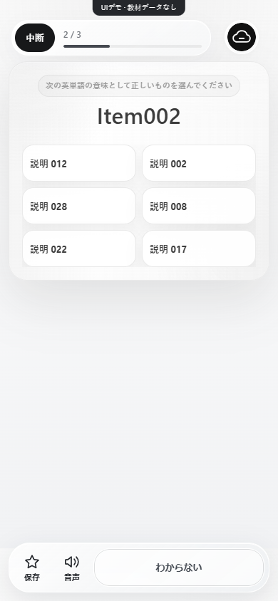
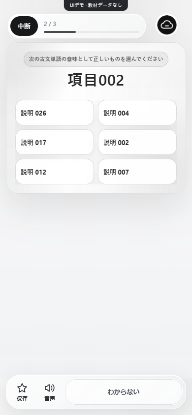

<div align="center">


**英語・古文の学習体験を、ひとつのコードベースに。**

白黒のガラスUI · スマホの操作性 · 教材とプログラムの分離

[はじめる](#はじめる) · [画面を見る](#画面を見る) · [構成](#構成) · [教材を追加する](docs/DATA.md) · [開発に参加する](CONTRIBUTING.md)

</div>

---

> **このリポジトリは、学習Webページのプログラムのみを公開しています。**
> 書籍由来の単語・訳語・発音辞書、利用者の学習記録、本番の認証設定は含みません。
> 初期状態ではプレースホルダーをプログラムで生成し、Firebase・本番の学習IDへ接続せずにUIを試せます。

## はじめる

Node.js 22以降で起動できます。外部パッケージのインストールやビルドは不要です。

```bash
git clone https://github.com/rattokun-1/dashcloudly-learning-web.git
cd dashcloudly-learning-web
npm start
```

[http://localhost:3000](http://localhost:3000) を開き、英語・古文を選びます。

| モード | できること | 接続先 |
| :--- | :--- | :--- |
| **Demo** — 初期状態 | 画面・問題操作・復習・進捗を試す | 端末内のみ |
| **Local** | 自分で用意した教材を使って学習 | 端末内のみ |
| **Connected** | 個別に構築した認証・同期基盤と接続 | ご自身のFirebase・学習ID |

HTMLを直接開く `file://` ではなく、ローカルサーバーを使ってください。

## 画面を見る

<table>
<tr>
<td align="center" width="50%"><strong>English</strong><br><br></td>
<td align="center" width="50%"><strong>Kobun</strong><br><br></td>
</tr>
</table>

画像内の「Item」「項目」「説明」は生成されたプレースホルダーです。

### 学習に集中できる操作

| Practice | Progress | Cloudly Glass |
| :--- | :--- | :--- |
| 選択・記述・間違いの復習 | 学習進捗・正答率・ブックマーク | 白黒・グレーのガラス表現 |
| 保存・音声・次へを下部に固定 | 同じブラウザーの途中位置から再開 | 縦向き・横向き・PCに対応 |
| 取得済み画面のオフライン利用 | 科目別の端末内記録 | アニメーション軽減に対応 |

音声はブラウザーの読み上げ機能を利用します。利用可能な声は端末によって異なります。
ランキング・学校管理・端末間同期は接続設定が必要です。公開版に共通学習IDのサーバー実装は含みません。

## 構成

```text
dashcloudly-learning-web/
├── index.html                  科目の選択画面
├── apps/
│   ├── english/                英語の学習画面・ロジック
│   └── kobun/                  古文の学習画面・ロジック
├── shared/
│   ├── bootstrap.js            設定・教材・プログラムの読み込み
│   ├── data-loader.mjs         教材の形式検証とUIデモ生成
│   ├── demo-runtime.mjs        外部接続をしないデモ用アダプター
│   └── config.example.json     個別設定のひな形
├── tools/                      ローカルサーバー・公開内容の検査
├── tests/                      データ境界と教材読み込みの検証
└── docs/                       導入・教材・公開方針
```

教材をコードへ埋め込まず、[教材ファイルの形式](docs/DATA.md)に沿って別途用意します。
接続モードの設定と運用上の制約は[導入ガイド](docs/SETUP.md)を確認してください。

## 公開内容を確認する

```bash
npm test
npm run audit:public
```

PRと `main` への更新ではGitHub Actionsも実行します。教材の埋め込み、データ用ディレクトリ、秘密鍵や実運用の認証設定を検出した場合は失敗します。

教材・個別設定・データベース・バックアップは `.gitignore` で除外しています。`git add -f` で除外を回避しないでください。
公開範囲と履歴の管理は[公開ポリシー](docs/PUBLICATION.md)にまとめています。

## 開発について

改善提案はIssue、変更は小さな目的ごとのPRで受け付けます。[CONTRIBUTING.md](CONTRIBUTING.md)を参照してください。

コードの再利用ライセンスは現時点では指定していません。教材の利用・公開に必要な権利は、各自で確認してください。

<div align="center">

<sub>Designed & maintained by Rattokun / DashCloudly</sub>

</div>
