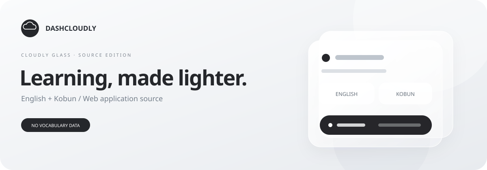
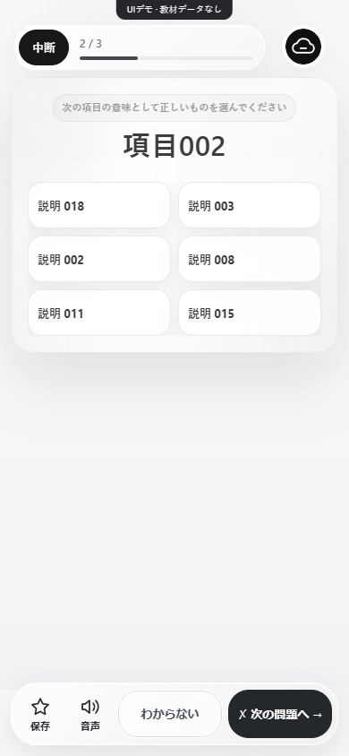

<div align="center">


# Dashcloudly Learning

**自分の教材で、自分のペースで。**

Cloudly Glassy 1.0 — 白黒とグレー、透けるガラス、迷わない操作。

[はじめる](#はじめる) · [教材を用意する](docs/DATA.md) · [相談する](https://github.com/rattokun-1/dashcloudly-learning-web/discussions) · [開発に参加する](CONTRIBUTING.md)



</div>

## できること

| 学ぶ | 振り返る | 自分に合わせる |
| :--- | :--- | :--- |
| 選択・入力形式で練習 | 進捗と正解数を確認 | 教材を差し替える |
| 続きから再開・復習 | 苦手な項目を整理 | マイリストを作る |
| スマホでも操作しやすく | 端末内に記録を保存 | 対応ブラウザーでPWAとして利用 |



> 公開対象は学習アプリのプログラムです。実教材・利用者情報・本番設定は含みません。初期状態では生成した項目でUIを試せます。

## はじめる

Node.js 22以降が必要です。追加パッケージのインストールやビルドは不要です。

```sh
git clone https://github.com/rattokun-1/dashcloudly-learning-web.git
cd dashcloudly-learning-web
npm start
```

[localhost:3000](http://localhost:3000) から「学習を試す」を開きます。

| モード | 使い方 |
| :--- | :--- |
| Demo（初期状態） | 設定なしでUIを確認。外部の認証・同期には接続しません |
| Local | 自分の教材を読み込み、ブラウザー内で学習します |
| Connected | 自分の認証・同期基盤に接続。別途サーバー実装と認可の設定が必要です |

[導入ガイド](docs/SETUP.md)・[教材の形式](docs/DATA.md)

## 一緒に作る

操作の感想、デザイン、アクセシビリティ、ドキュメント、コードの改善を歓迎します。

- [不具合・機能・デザインを提案する](https://github.com/rattokun-1/dashcloudly-learning-web/issues/new/choose)
- [小さな課題から始める](https://github.com/rattokun-1/dashcloudly-learning-web/labels/good%20first%20issue)
- [相談・アイデアを共有する](https://github.com/rattokun-1/dashcloudly-learning-web/discussions)
- [変更を送る手順](CONTRIBUTING.md)・[開発の構成](docs/DEVELOPMENT.md)

## ライセンス

プログラムは [MIT](LICENSE) です。利用・改良・再配布できます。名称・ロゴは対象外です。[ブランドの扱い](docs/BRAND.md)を確認してください。教材の権利は各権利者に帰属し、本ライセンスでは利用許諾されません。

教材・秘密情報の混入をCIで検査します。[公開ポリシー](docs/PUBLICATION.md)に従い、画像やPRにも実データを含めないでください。脆弱性は [非公開の報告窓口](SECURITY.md)へ。

[配布版とパッケージ](docs/RELEASES.md) · [最新Release](https://github.com/rattokun-1/dashcloudly-learning-web/releases/latest)
